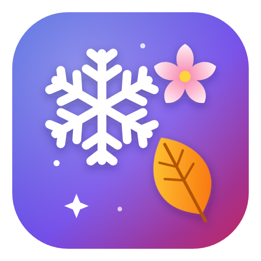
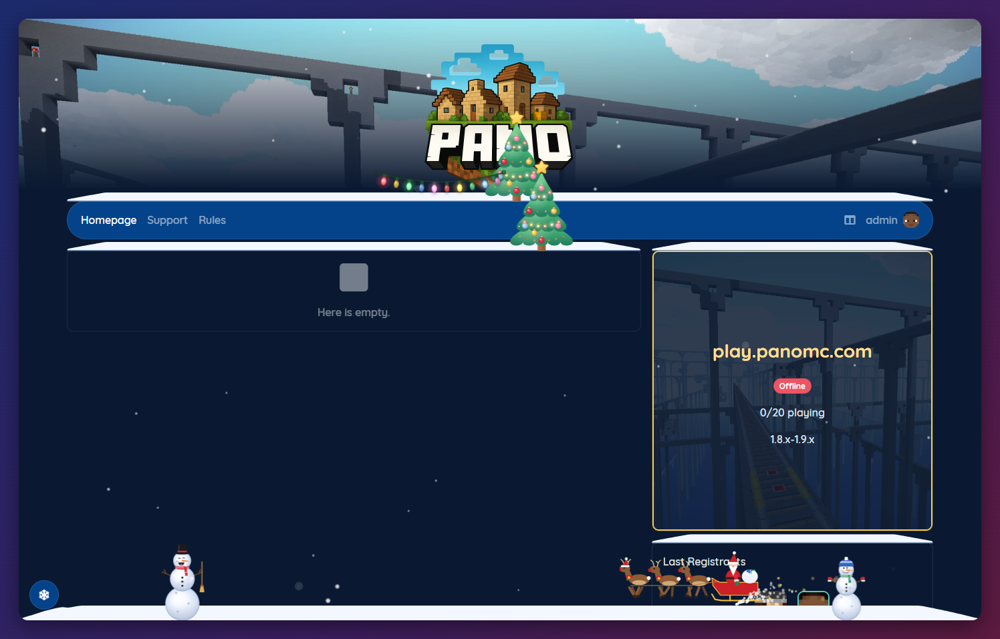
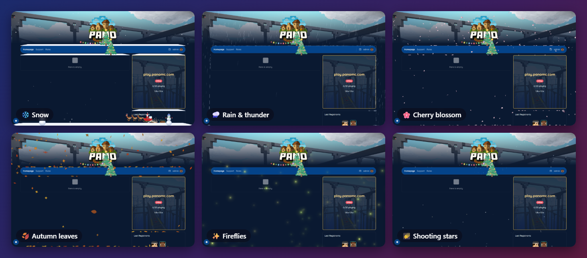
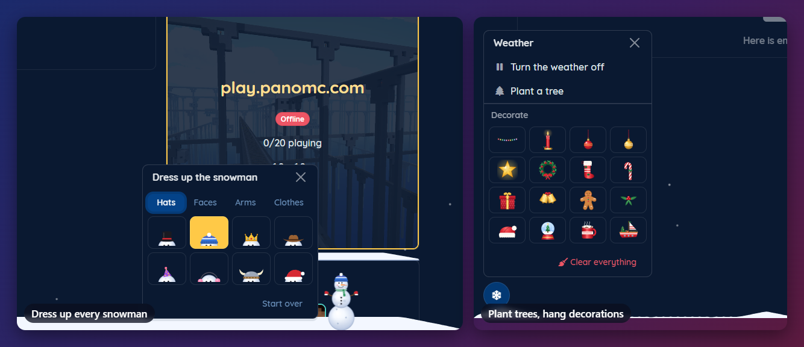
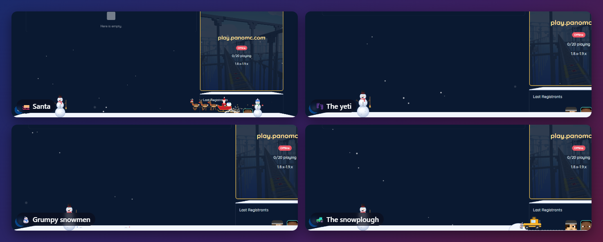
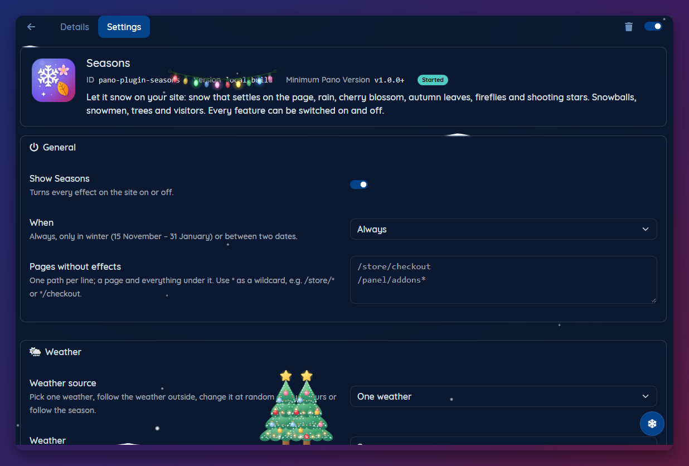

# Seasons

### Let it snow — on your website.

Snow that settles on your pages. Rain, cherry blossom, autumn leaves, fireflies and shooting stars. 
Snowballs your visitors can throw, snowmen they can dress up. Free, forever.

  
  
  
  

Seasons is <a href="https://github.com/duruer/frostpane"><b>Frostpane</b></a>, the desktop app that lets it snow on your windows, made for Pano websites.

 

## ❄️ Your website, but cosier

Turn it on and your website becomes a little winter scene. Snowflakes drift down and **pile up on your menu bar, your cards and your footer**. Scroll, and the snow stays right where it landed.

It never gets in the way. Clicks go straight through the weather to your links and buttons, and it looks at home on every Pano theme, light or dark.

## 🌦️ Six kinds of weather

| | | |
|:-:|:-:|:-:|
| ❄️ **Snow** Gentle flurries or a full blizzard | 🌧️ **Rain** Soft drizzle or a thunderstorm | 🌸 **Cherry blossom** Pink petals on a spring breeze |
| 🍂 **Autumn leaves** Golden leaves tumbling by | ✨ **Fireflies** Little lights in the dark | 🌠 **Shooting stars** Make a wish |

Can't decide? Pick your city and **follow the weather outside**: when it snows there, it snows on your website. Or let it **change by season**, or **surprise your visitors** with a new weather every few hours.

## ⛄ Play in the snow

- **Roll snowballs.** Sweep the mouse through deep snow and a snowball starts to form.
- **Throw them.** Grab one and fling it across the page.
- **Build a snowman.** Stack three snowballs and say hello.
- **Dress it up.** Top hats, crowns, scarves, sunglasses, a broom and plenty more.
- **Decorate.** Plant a Christmas tree, then hang string lights, candles and baubles wherever you like.

Every visitor gets their own snowmen and trees. They are still there the next time they drop by.

## 🛷 Some friends drop by

Santa flies over, the snowplough clears the way, the yeti stomps through, and two grumpy snowmen settle things with a snowball fight.

## 🎛️ You're in charge

**Every single feature has its own switch.** Turn on only the snow, or go all out with visitors and decorations. Show it all year, only in winter, or between two dates. Let it snow in your admin panel too, and keep it off pages like your checkout (wildcards welcome). Choose the wind, how much falls and how fast.

## 💙 Made to be nice

- **Free, forever.** No ads, no premium tier, nothing locked away.
- **Polite.** It never steals a click. A small button lets every visitor turn the weather off for themselves.
- **Light.** It rests whenever nobody is looking at the page.
- **Kind.** Visitors who ask their device for less motion see a calm page.
- **Private.** Your visitors' browsers never talk to a weather service. Your website asks once in a while, for everyone.
- **Speaks your language.** English, Türkçe and Русский.

## 📥 Get Seasons

1. Open your Pano panel and go to **Addons**.
2. Find **Seasons** and click **Install**.
3. Open its **Settings**, pick a weather and press **Save**. That's it.

## ❄️ Made from Frostpane

Seasons is the website version of **[Frostpane](https://github.com/duruer/frostpane)**, a free desktop app that lets it snow on your Windows, macOS and Linux desktop. Same snow, same snowmen, same grumpy visitors, now on your Pano website.

 
Weather data by <a href="https://open-meteo.com/">Open-Meteo</a> · Made with ❄️ for everyone who wishes it snowed more often.

